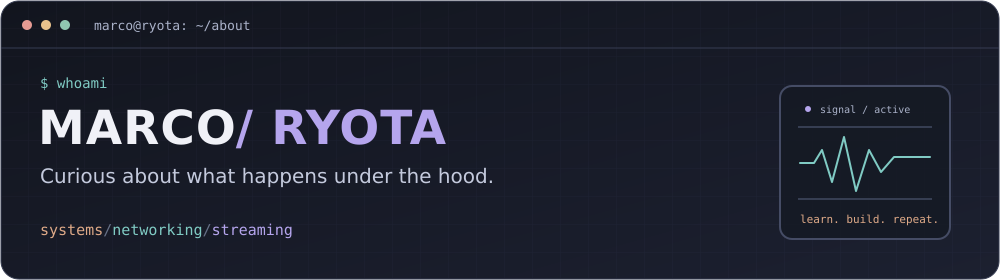

  

  <strong>Data Platform Engineer by day. Curious about systems, always.</strong> 
  Curitiba, Brazil · Computer Science @ UNINTER

  
  
  

### `~/about`

Hey, I'm **Marcos Eduardo**, also known as **Marco / Ryota** 👋

I work as a **Junior Data Platform Engineer at MadeiraMadeira**, building data infrastructure, cloud automation, and tools for technical teams. My experience also includes applied AI, from documentation retrieval to LLM-assisted code review.

What keeps me curious is what happens underneath: **how memory is managed, how systems communicate, and how audio and video move across a network**. I enjoy digging into technical problems and building things I would use myself.

### `~/learning`

🦀 **Rust is my current focus** — studying through [JetBrains Academy](https://academy.jetbrains.com/course/16631), with ownership, borrowing, types, and error handling at the core.

My study direction:

- **Foundations:** memory management, concurrency, and operating systems.
- **Networking & streaming:** protocols and the systems behind connected applications.
- **Long term:** systems software with **Rust and C++**, with an interest in embedded systems too.

### `~/projects`

| Project | What I explored |
| :--- | :--- |
| 🧠 **[GCP AI Copilot](https://github.com/RyotaMarco/gcp-rag)** | Documentation retrieval with FastAPI, LangChain, Qdrant, and Groq/Llama. Packaged with Docker Compose. |
| 📡 **[TwitchPipeline](https://github.com/RyotaMarco/TwitchPipeline)** | Twitch stream metadata, PySpark, AWS orchestration, and contextual analysis with Gemini. |

### `~/toolbox`

  
  
  
  
  
  
  

<strong>Expand the stack</strong>

- **Data & orchestration:** SQL, Airflow / Cloud Composer, Dataform, BigQuery, and Dataflow.
- **Cloud & automation:** Python, GCP, AWS, and Docker.
- **APIs & applied AI:** FastAPI, LangChain, Gemini, and Qdrant.
- **Currently learning:** Rust and the foundations of systems programming.

### `~/off-the-clock`

🎮 **Games** · 🎧 **Music** · 🌙 **Anime** · 🐧 **Linux tinkering**

<strong>A little more Ryota</strong>

You'll also find me playing **Final Fantasy XIV** or watching **Monogatari**.

My interest in music, games, and streaming feeds back into code: I'm drawn to the software behind the experiences I enjoy, from media systems to tools and automation.

---

  Learning how it works. Building something with it.

