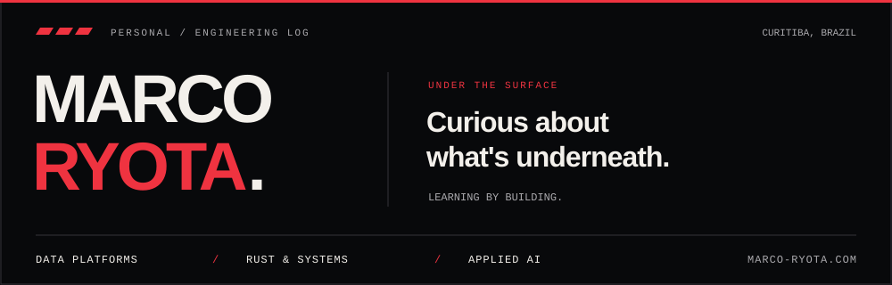

  

  <strong>Junior Data Platform Engineer @ MadeiraMadeira</strong> 
  Curitiba, Brazil · Computer Science @ UNINTER

  
  
  

### About

Hey, I'm **Marcos Eduardo**, also known as **Marco / Ryota**.

I build **data infrastructure, cloud automation, and tools for technical teams** at MadeiraMadeira. My day-to-day includes Python, SQL, and Google Cloud; my projects also explore AWS and applied AI.

I'm curious about what happens underneath: **how memory is managed, how applications communicate, and how audio and video move across networks**. I enjoy building things I would use myself and keeping notes on what I learn.

### Under the surface

| Focus | Where I am |
| :--- | :--- |
| **Data platforms & cloud** | My day-to-day at MadeiraMadeira: pipelines, orchestration, infrastructure, and automation. |
| **Rust & systems** | Currently learning ownership, borrowing, types, and error handling through [JetBrains Academy](https://academy.jetbrains.com/course/16631), alongside memory management, concurrency, and operating-system fundamentals. |
| **Applied AI** | Exploring hybrid retrieval, embeddings, source-grounded answers, MCP, and LLM-assisted tooling. |
| **Longer-term direction** | Networking, audio/video streaming, and systems software with Rust and C++; embedded systems are an interest too. |

### Built to understand. Made to work.

| Project | What it explores | Current form |
| :--- | :--- | :--- |
| **[GCP AI Copilot](https://github.com/RyotaMarco/gcp-rag)** | Bilingual documentation assistant with hybrid retrieval, source references, and read-only MCP tools over fictional cloud resources. | Local Docker application + [public Cloudflare demo](https://gcp.marco-ryota.com). The demo covers a limited documentation corpus and has usage limits. |
| **Portfolio** | Project write-ups and engineering notes, built with React, Vite, Bun, and Markdown. | Published on Cloudflare; source repository is private. |
| **[TwitchPipeline](https://github.com/RyotaMarco/TwitchPipeline)** | Twitch metadata, PySpark transformations, AWS orchestration, and contextual analysis with Gemini. | Portfolio project with implementation and architecture notes. |
| **[Discord Music Bot](https://github.com/RyotaMarco/DiscordBot)** | Music playback, queues, playlists, and audio effects with Python, the Discord API, and FFmpeg. | Earlier personal project connecting code and music. |

More context lives in the [project write-ups](https://marco-ryota.com/projects) and [engineering notes](https://marco-ryota.com/reports).

### Toolbox

  
  
  
  
  
  
  

<strong>A little more of the stack</strong>

- **Data & orchestration:** SQL, BigQuery, Airflow / Cloud Composer, Dataform, Dataflow, and PySpark.
- **Cloud & automation:** Python, Google Cloud, AWS, and Docker.
- **APIs & applied AI:** FastAPI, Qdrant, hybrid retrieval, embeddings, Gemini, Groq, and MCP.
- **Portfolio:** React, Vite, Bun, Markdown, and Cloudflare.
- **Currently learning:** Rust and the foundations of systems programming.

### After hours

**Linux · Music · FFXIV · Anime**

<strong>A little more Ryota</strong>

You'll also find me playing **Final Fantasy XIV**, watching **anime**, listening to music, or tinkering with Linux.

Games, music, and streaming keep pulling me toward the software behind connected and interactive experiences.

---

  Curious about what's underneath. Learning by building. 
  <a href="https://marco-ryota.com">Portfolio</a> · <a href="https://marco-ryota.com/reports">Notes</a> · <a href="https://www.linkedin.com/in/marcoryota/">Let's connect</a>

